# NEEDY GIRL OVERDOSE — 3DS fan port

An unofficial Nintendo 3DS / 2DS port of NEEDY GIRL OVERDOSE, made as an academic project.
It runs the original game logic (translated from C# to Lua) on a small C engine built with
citro2d, and spreads the Windose desktop across the two screens: Ame's webcam and the stream on
top, the touch desktop below.

  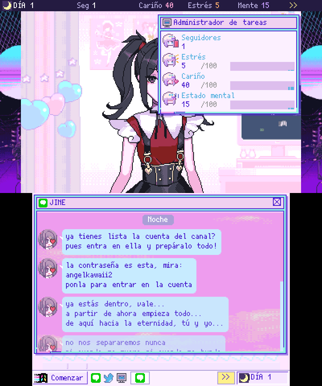
  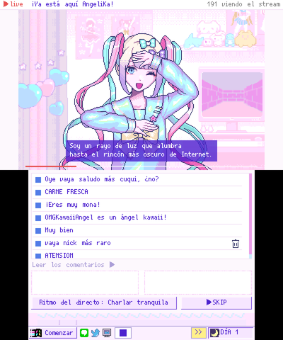
  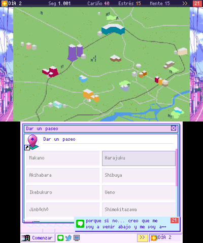
  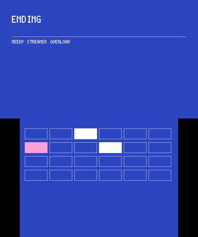

**Everything is in [`port3ds/`](port3ds/)** — see its [README](port3ds/README.md) for features,
controls, installation and build instructions.

## Download

**Test builds with the game data inside** ([v1.0.15](https://github.com/Mirezepam/needy-girl-overdose-3ds/releases/tag/v1.0.15)) — private repository,
for personal testing only. Nothing to copy to the SD card: the data travels inside each file.

| File | Version | How to use it |
|---|---|---|
| [`needy3ds_full.cia`](https://github.com/Mirezepam/needy-girl-overdose-3ds/releases/download/v1.0.15/needy3ds_full.cia) | Standard | Install with FBI → HOME Menu |
| [`needy3ds_full.3dsx`](https://github.com/Mirezepam/needy-girl-overdose-3ds/releases/download/v1.0.15/needy3ds_full.3dsx) | Standard | Copy to `sdmc:/3ds/` → Homebrew Launcher |
| [`needy3ds_3d.cia`](https://github.com/Mirezepam/needy-girl-overdose-3ds/releases/download/v1.0.15/needy3ds_3d.cia) | Stereoscopic 3D | Install with FBI → HOME Menu ("Ame-chan 3D") |
| [`needy3ds_3d.3dsx`](https://github.com/Mirezepam/needy-girl-overdose-3ds/releases/download/v1.0.15/needy3ds_3d.3dsx) | Stereoscopic 3D | Copy to `sdmc:/3ds/` → Homebrew Launcher |

**Engine only** ([v1.0.14](https://github.com/Mirezepam/needy-girl-overdose-3ds/releases/tag/v1.0.14)): `needy3ds.3dsx` / `needy3ds.cia`, which read the
data folder from `sdmc:/3ds/needy3ds/`, generated from your own Steam copy of the game (see
[Building the data](port3ds/README.md#building-the-data-and-the-executable-pc)).

Saves, settings and the log always go to `sdmc:/3ds/needy3ds/`. Sound needs the DSP firmware dump
(`sdmc:/3ds/dspfirm.cdc`, made with DSP1).

## Screenshots

Both screens at the 3DS's native resolution (top 400×240, bottom 320×240).

<table>
<tr><td align="center">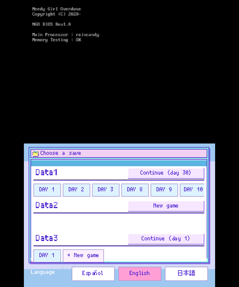 Title screen and save slots</td><td align="center"> JINE chat with Ame</td><td align="center">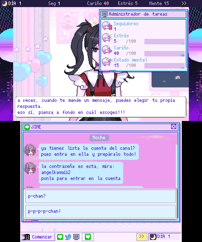 Choosing a reply</td></tr>
<tr><td align="center"> Live stream</td><td align="center">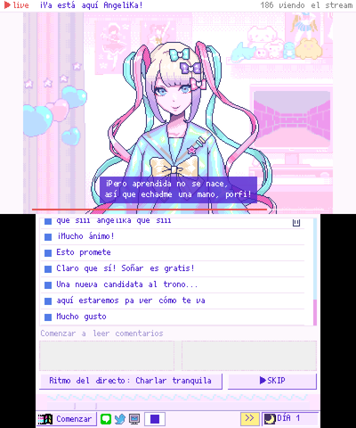 Reading the stream chat</td><td align="center">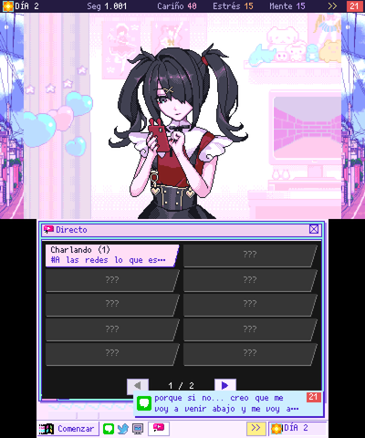 Picking the stream topic</td></tr>
<tr><td align="center">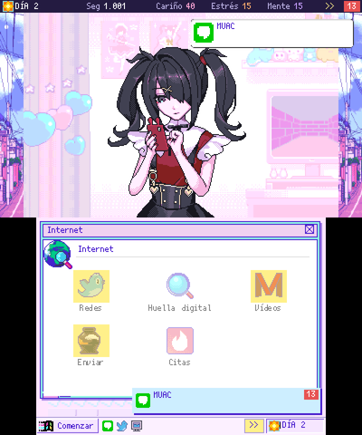 Internet</td><td align="center">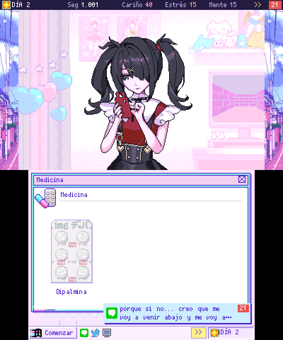 Medicine</td><td align="center"> Going out (map on top)</td></tr>
<tr><td align="center">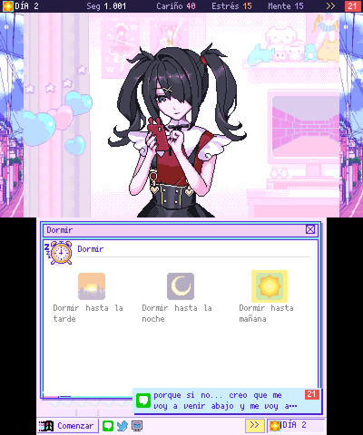 Sleep</td><td align="center">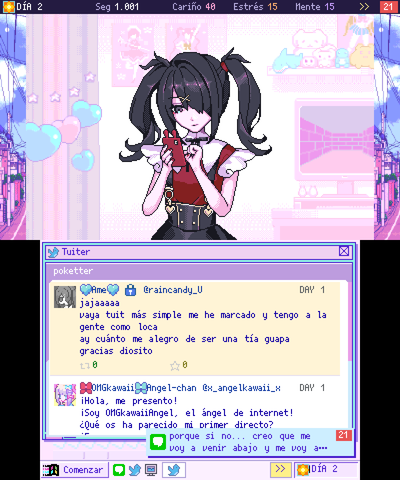 Poketter</td><td align="center">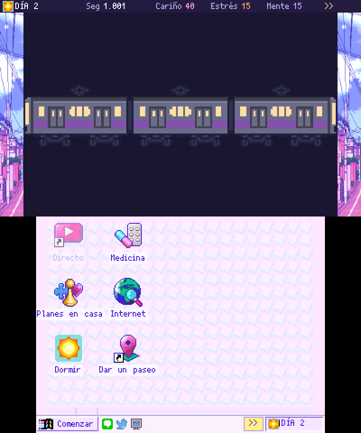 Train ride</td></tr>
<tr><td align="center">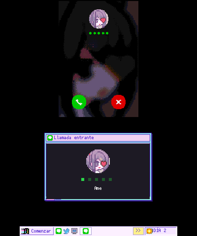 Ame is calling</td><td align="center">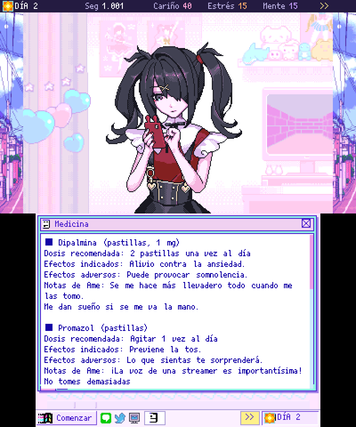 Package insert</td><td align="center">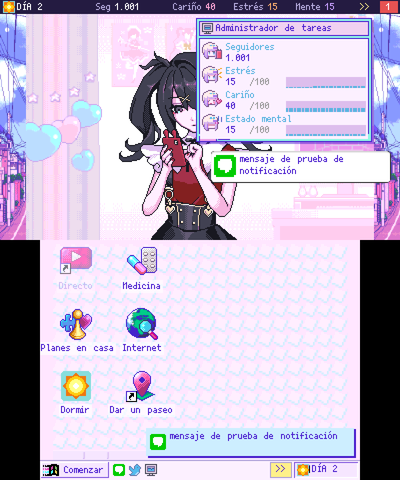 Task Manager</td></tr>
<tr><td align="center">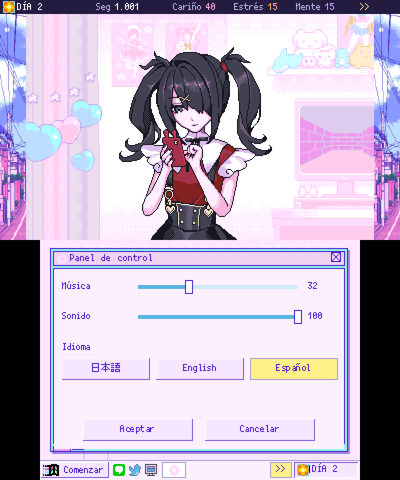 Control Panel</td><td align="center">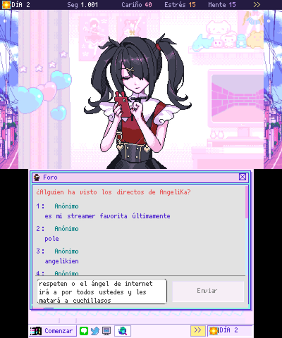 Message board</td><td align="center">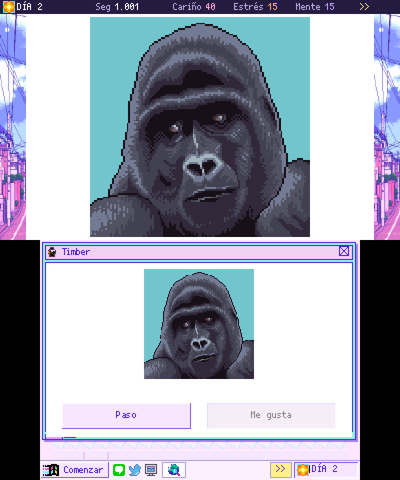 Dinder</td></tr>
<tr><td align="center">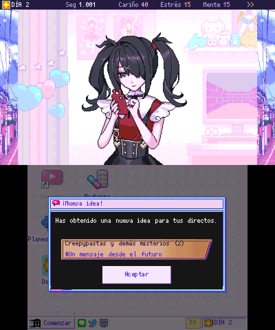 New stream idea</td><td align="center">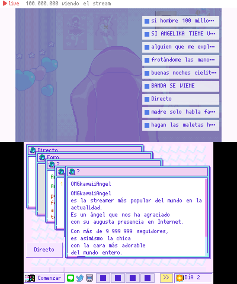 Internet Angel</td><td align="center">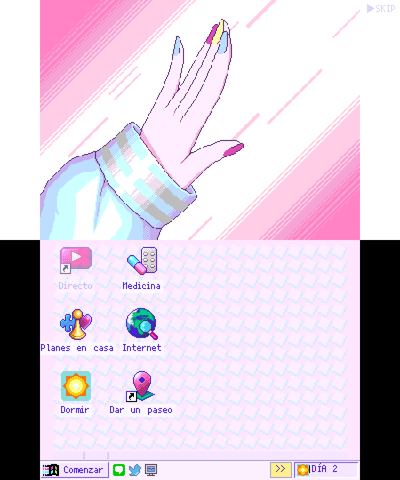 Stream opening</td></tr>
<tr><td align="center">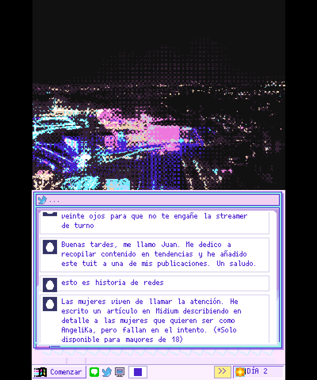 Ending</td><td align="center"> Ending screen</td><td align="center">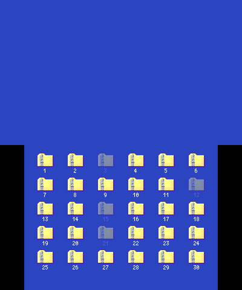 Choosing a ZIP after an ending</td></tr>
<tr><td align="center">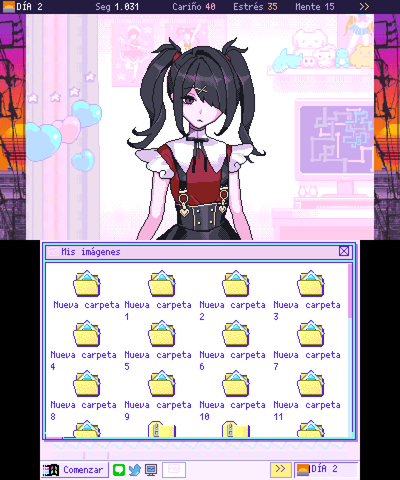 My Pictures</td><td align="center">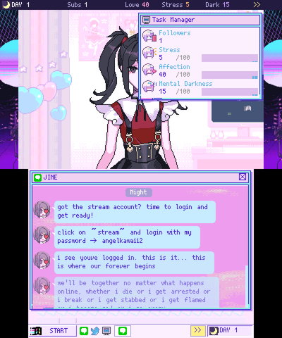 English: JINE</td><td align="center">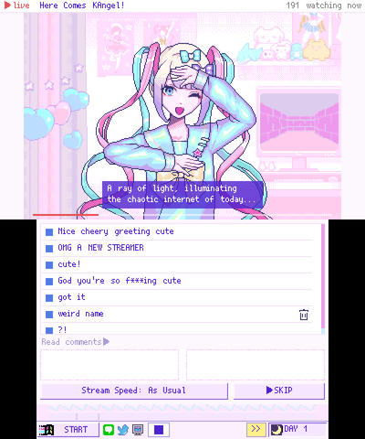 English: stream</td></tr>
<tr><td align="center">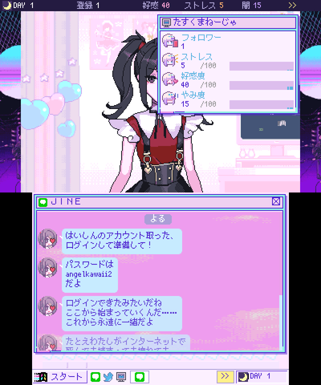 Japanese: JINE</td><td align="center">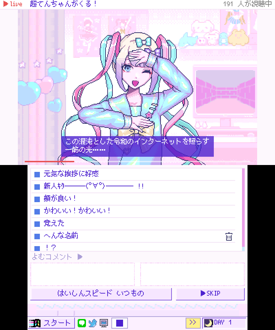 Japanese: stream</td><td align="center">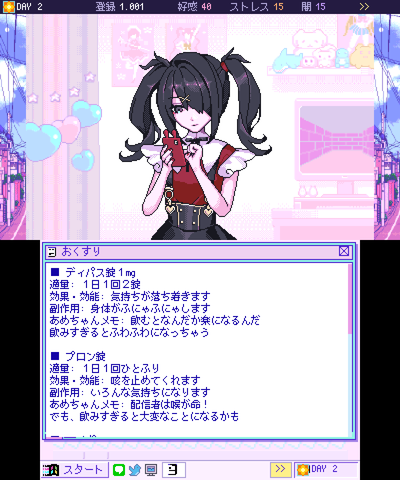 Japanese: package insert</td></tr>
</table>

## Repository layout

| Path | Contents |
|---|---|
| `port3ds/source/` | C engine: graphics, input, audio, video, Lua bindings (plus Lua 5.4 and LZ4) |
| `port3ds/lua/gen/` | Game logic translated from the original C# by `cs2lua` |
| `port3ds/lua/runtime/`, `port3ds/lua/override/` | Unity-like runtime and replacements for engine-bound classes |
| `port3ds/lua/ui/` | Dual-screen Windose UI and every in-game app |
| `port3ds/tools/` | Asset extraction/conversion, `cs2lua`, PC test harness, emulator scripts |
| `port3ds/docs/` | Design notes, screen mapping and event catalogue (Spanish) |

## Not included

Extracted game material (`assets/`, `code/`, `raw_data/`) and the generated 3DS data folder
(`port3ds/build_data/`) are excluded with `.gitignore`. They are copyrighted and must be
generated from your own Steam copy of the game.

## Legal

NEEDY GIRL OVERDOSE © WSS playground / xemono. This project is not affiliated with or endorsed by
the original developers, is non-commercial, and is intended for personal study only.
